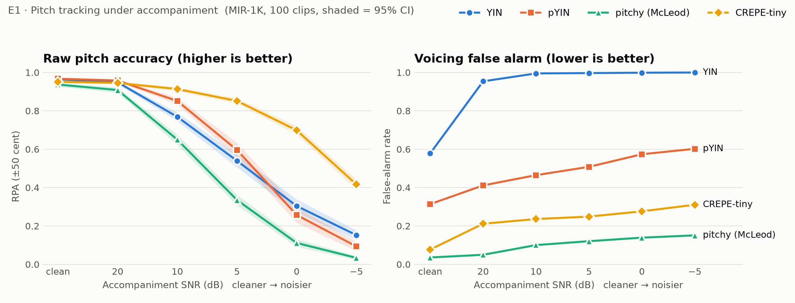

# #6 pkboie：即時判分、音高準確度

> 最後更新：2026-11-28（E1 只用 MIR-1K；W3 改用錯誤注入）

## 目前在做

- 沒有進行中的 branch（PR #20 已 merge）
- 內容：W3 改用錯誤注入（PROJECT_PLAN 第 9 節，11/29 會議確認）；下一步寫共用的 `experiments/inject_errors.py`（12/01）

## 本週目標（對照 PROJECT_PLAN.md）

- [x] 讀 `frontend/main.js` 的 `sample()`、`experiments/pitch_benchmark.py`
- [x] 下載並解壓 MIR-1K、Acapella 到 `data/datasets/`
- [x] 在 MIR-1K 上跑通 benchmark，產出 10 段的初步數字
- [x] 修改 A：`pitch_benchmark.py --dataset mir1k`
- [x] 開 PR 合併修改 A（PR #6，11/23）
- [x] pitchy Node 腳本，E1 有 3 種方法（YIN、pYIN、pitchy）
- [x] MIR-1K 100 段 + 各 SNR 的完整數字
- [x] E1 的圖
- [x] CREPE-tiny 加入 E1
- [x] 逐音符判分改進（M2 檢查點 11/29，PR #20）
- [x] E1 範圍確認：只用 MIR-1K（demo 歌不適合當標準答案，原因見下方）
- [x] W3 錯誤注入提案、整合組員回饋進 PROJECT_PLAN 第 9 節

## 已完成

- 2026-11-19：資料集解壓（MIR-1K 1000 段、Acapella 6 首）；建 `.venv`、產生 demo 歌、`tests/simulate_singing.py` 通過
- 2026-11-19：新增 `docs/git_workflow.md`、`docs/members/`
- 2026-11-23：**修改 A 完成**（見下方「給大家的使用說明」）
  - `pitch_benchmark.py` 新增 `--dataset mir1k`：讀 MIR-1K 右聲道（人聲），以 `PitchLabel/*.pv` 人工標註當答案，解決原本「pYIN 自己考自己」的循環論證
  - 實作 E1 指標 `compare_to_reference()`：`rpa`、`rca`、`voicing_recall`、`voicing_fa`、`mean_abs_cents`
  - 結果輸出 CSV（`experiments/results/pitch_benchmark.csv`），每段 × 方法 × SNR 一列
  - 新增 `tests/check_pitch_metrics.py`：用手算的小資料檢查五個指標，全部通過
- 2026-11-23：**pitchy 加入 E1**
  - `experiments/pitchy_f0.mjs`：Node 跑 `frontend/vendor/pitchy.js`，判斷條件和 `main.js` 完全一致（2048 樣本、clarity > 0.85、RMS > 0.01、60–1100 Hz）
  - `pitch_benchmark.py --methods pitchy`：先重新取樣到 48 kHz（瀏覽器麥克風的取樣率，2048 樣本 ≈ 43 ms，與 demo 一致）
  - MIR-1K 100 段 × 3 方法 × 6 種 SNR：`experiments/results/e1_mir1k_100_snr.csv`
- 2026-11-25：**E1 圖**
  - `experiments/plot_e1.py` → `experiments/results/e1_snr.png`；`summarize()` 算每個 (方法, SNR) 的平均與 95% CI（NaN 不算進 n）
  - `tests/check_plot_summary.py`：手算小資料檢查 `summarize()`，通過
- 2026-11-27：**CREPE-tiny 加入 E1**
  - 100 段 × 6 種 SNR：`experiments/results/e1_mir1k_100_snr_crepe.csv`（和 `e1_mir1k_100_snr.csv` 同一批段，`plot_e1.py` 預設兩個一起讀）
  - `plot_e1.py` 新增 `paired_diff()`：同一段 a − b 的平均、95% CI、各自較好的段數；`tests/check_paired_diff.py` 手算檢查，通過
- 2026-11-27：**逐音符判分改進**（`frontend/note-judge.js`）
  - 音符開頭 min(80 ms, 音符長度 ÷ 2) 不算（唱新音時的滑音不是唱錯）
  - 音符唱完後，每格先折八度再取**中位數**，|中位數| < 容許值 = 命中；唱到的格數 < 30% → 未判定（和後端 `per_note` 的 coverage 一致）
  - 即時命中率改成「已判定的音符中命中幾個」，和結果頁同單位
  - `tests/check_note_judge.mjs`：18 個手算案例，通過
- 2026-11-28：**E1 範圍調整：只用 MIR-1K**（見下方「E1 範圍調整」）
- 2026-11-28：**W3 錯誤注入提案**：song6 前 60 秒原型找到 3 個評分問題（真歌拖拍不扣分、音高錯誤扣到節奏、原唱表現力 22）；#1、#3、#4、#5 回饋已整合進 PROJECT_PLAN 第 9 節

## E1 範圍調整（2026-11-28）

PROJECT_PLAN 的 E1 原本是「MIR-1K 100 段 + 2 首手動修正的 demo 歌」，**改成只用 MIR-1K**。

- demo 歌的參考音符是 pYIN 自動產生、人工只檢查明顯錯誤（對 demo 畫面足夠）。要當 E1 的標準答案，需要逐音符校正音高與起訖時間，以目前人力做不到
- 直接拿來評估會偏向 pYIN（循環論證）。實測 song6 前 60 秒 117 個音符，逐音符正確率（每音符取中位數、±50 cent）：

  | 方法 | 逐格 rpa | 逐音符 |
  | --- | --- | --- |
  | YIN | 0.748 | 0.991 |
  | pYIN | 0.783 | **1.000** |
  | pitchy | 0.456 | 0.663 |

  pYIN 拿到 100% 是因為答案就是它產生的。另外部分音符的結束時間比實際演唱晚（例：14.15 s「愛」，15.0 s 後歌手已唱下一個音），跳過音符開頭後三種方法都變差，表示音符邊界也不適合當答案
- MIR-1K 本身是業餘歌手演唱中文流行歌、人工逐格標註，和本系統的使用情境相近
- 已用 MIR-1K 20 段確認 pitchy 的時間對齊正確（前後挪動 ±20 ms 吻合率都下降，0 ms 最高 0.955），E1 的 pitchy 數字有效

## E1 結果（MIR-1K 隨機 100 段，seed 0）

### 純人聲

| 方法 | rpa（95% CI）| rca | voicing_recall | voicing_fa | mean_abs_cents |
| --- | --- | --- | --- | --- | --- |
| YIN | 0.965 ± 0.006 | 0.971 | 1.000 | 0.578 | 12.2 |
| pYIN | 0.967 ± 0.005 | 0.968 | 0.994 | 0.314 | 11.7 |
| pitchy | 0.937 ± 0.011 | 0.942 | 0.943 | **0.036** | **7.7** |
| CREPE-tiny | 0.951 ± 0.006 | 0.951 | 0.960 | 0.077 | 13.2 |

- YIN vs. pYIN：兩個 CI 重疊，但兩者跑的是**同樣 100 段**，應該用**配對比較**（同一段相減再算 CI；兩者逐段相關 0.92，段落難度的晃動會抵消）：
  pYIN − YIN = **+0.0025 ± 0.0023**（95% CI 不含 0；39 段較好、26 段較差、35 段平手）→ pYIN **統計上略好，但只差 0.25 個百分點，實務上可忽略**
- pitchy 明顯較低
- CREPE-tiny vs. pYIN（配對）：crepe − pYIN = **−0.016 ± 0.004**（10 段較好、83 段較差）→ 顯著但差距小；損失來自有聲判斷較保守（recall 0.960 vs. 0.994），說有聲時 99% 正確（rpa ÷ recall 0.991）
- CREPE 的 `mean_abs_cents` 偏高有一部分是 torchcrepe 自己加的：輸出音高每格 20 cent，會加 ±20 cent 的隨機 dither（`torchcrepe/convert.py`，沒有 seed → 每次跑 cent 數字略有不同）
- pitchy 的損失幾乎全是**漏聽**（rpa ≈ recall），聽到時誤差最小、誤報率比 pYIN 低近 10 倍 → 支持前端選用 pitchy
- **YIN 的 recall = 1.000 不代表它好**：我們 `detect_pitch()` 裡 YIN 的有聲判斷是「音量 > 最大音量 2%」（`scoring/pitch_utils.py:42`），幾乎全判有聲。報告要註明
- pitchy 的耗時（約 23 ms／秒）含重新取樣與啟動 Node，**不是演算法速度**，不要拿來和 YIN／pYIN 比

### 混入伴奏（rpa / voicing_fa）



（`python experiments/plot_e1.py` 重畫；陰影 = 95% CI）

| SNR (dB) | YIN | pYIN | pitchy | CREPE-tiny |
| --- | --- | --- | --- | --- |
| clean | 0.965 / 0.578 | 0.967 / 0.314 | 0.937 / 0.036 | 0.951 / 0.077 |
| 20 | 0.948 / 0.954 | 0.958 / 0.411 | 0.908 / 0.050 | 0.945 / 0.211 |
| 10 | 0.769 / 0.995 | 0.851 / 0.465 | 0.650 / **0.100** | **0.913** / 0.236 |
| 5 | 0.540 / 0.997 | 0.596 / 0.508 | 0.335 / 0.121 | **0.851** / 0.249 |
| 0 | 0.304 / 0.999 | 0.257 / 0.574 | 0.111 / 0.139 | **0.699** / 0.276 |
| −5 | 0.152 / 1.000 | 0.093 / 0.602 | 0.034 / 0.151 | **0.417** / 0.311 |

四種方法壞掉的方式不同：
- **YIN**：把伴奏當人聲（10 dB 時 fa 0.995），八度錯誤大增
- **pYIN**：rpa 最穩，但誤報升到一半。10 dB 配對比較 pYIN − YIN = **+0.083 ± 0.014**（93 段較好、7 段較差）→ 有伴奏時明顯比 YIN 穩
- **0 dB 以下 YIN 的 rpa 反超 pYIN 是假象**：YIN 每格都判有聲（recall 1.000），不會因漏判失分；看「聽到的格子答對幾成」（rpa ÷ recall），0 dB 時 YIN 0.30、pYIN 0.37、pitchy 0.49
- **pitchy**：伴奏讓 clarity 掉到門檻 0.85 以下 → 整格丟掉，**漏聽而不亂猜**（10 dB 時聽到的格子仍有 9 成正確）
- → 「一定要戴耳機」的量化依據：伴奏漏到 10 dB，pitchy 漏掉約 28% 的演唱
- **CREPE-tiny**：有伴奏時 rpa 最穩。10 dB 配對比較 crepe − pYIN = **+0.062 ± 0.019**（79 段較好、17 段較差）；0 dB 時 rpa ÷ recall = 0.95（pYIN 0.37）。代價是 fa：20 dB 就從 0.077 跳到 0.211 —— 人聲停下來（換氣）時只剩伴奏，CREPE 會抓到**伴奏樂器的音高**（`titon_5_04` 誤判格中 81% 與單獨伴奏的音高相差 < 50 cent）
- CREPE 用的是 torchcrepe 預設的 **Viterbi 解碼（看整段）**，和 pYIN 一樣**不能即時**；速度中位數 77 ms／秒音訊（CPU）。在本專題定位為離線的上限參考，前端仍用 pitchy
- `mean_abs_cents` 在 ≤ 5 dB 時接近隨機（約 200 cent），只看到 10 dB 即可

## 給大家的使用說明

### 指標定義（報告可直接引用）

| 指標 | 計算方式 | 意義 |
| --- | --- | --- |
| `rpa` Raw Pitch Accuracy | 標註有聲的 frame 中，誤差 < 50 cent 的比例（偵測成無聲算錯，同 MIREX） | 音高正確率 |
| `rca` Raw Chroma Accuracy | 同上，但忽略八度 | `rca − rpa` = 八度錯誤的比例 |
| `voicing_recall` | 標註有聲的 frame 中，偵測也判有聲的比例 | 有唱的地方聽到幾成 |
| `voicing_fa` | 標註無聲的 frame 中，偵測卻判有聲的比例 | 誤報（例如把伴奏當人聲） |
| `mean_abs_cents` | 兩邊都有聲的 frame，折八度後的平均 \|cent 誤差\| | 聽對時有多準 |

### 指令

```bash
python experiments/pitch_benchmark.py --limit 10                       # MIR-1K 隨機 10 段
python experiments/pitch_benchmark.py --limit 100 --methods yin pyin crepe   # crepe 需另外安裝，見下方
python experiments/pitch_benchmark.py --snr-db clean 20 10 5 0 -5      # 混入伴奏
python experiments/pitch_benchmark.py --dataset song --song <id>       # 自家歌（song.json 必須手動修正過）
python tests/check_pitch_metrics.py                                    # 檢查指標
node tests/check_note_judge.mjs                                        # 檢查逐音符判分
python experiments/plot_e1.py                                          # 重畫 E1 圖 + 印出 crepe − pYIN 配對比較
```

**CREPE 的安裝（只裝 CPU 版）**：torchcrepe 會 import torchaudio，而 PyPI 上的 torchaudio 是 CUDA 版（沒有 NVIDIA GPU 會出現 `libcudart.so` 錯誤）。CPU 版 torchaudio 支援 Python 3.14 的最新版是 2.11，torch 要同版本：

```bash
uv pip install --python .venv torch==2.11.0 torchaudio==2.11.0 --index-url https://download.pytorch.org/whl/cpu
uv pip install --python .venv torchcrepe
```

參數：`--limit 0` = 全部 1000 段；`--seed` 換抽樣；`--out` 改輸出路徑。

### MIR-1K 的格式（自己讀資料時要注意）

- 16 kHz 雙聲道，**右聲道 = 人聲、左聲道 = 伴奏**
- `PitchLabel/*.pv`：每行一個 MIDI 值（可為小數），0 = 無聲
- **每 20 ms 一筆、第一筆在 20 ms**（鏡像 readme 寫 10 ms 是錯的）。已驗證：前後偏移 20 ms 吻合率都會下降

## 卡住／需要別人

- **#1**：E3 的 MIR-1K 結果可直接參考（上表，`e1_mir1k_100_snr.csv`，同一批 100 段）。耳機 vs. 喇叭改成模擬為主（PROJECT_PLAN 第 9 節）。`pitch_benchmark.py` 現在需要 `psutil`，跑之前請重新 `pip install -r requirements.txt`
- **#2**：E2 請把耗時和記憶體**分開跑**：開 `--profile-memory` 時 YIN、pYIN 會慢 2 倍多（Demo 實測 YIN 16 → 31 ms/s），pitchy 不受影響。耗時用 `--limit 100`（同 E1 的段）跑 3 次取中位數；第一段有暖機（YIN 38 ms，之後 2–3 ms）
- **#4**：真人示意 6 段請同時存音檔，我會拿來做前後端一致性的重播
- **#5**：`inject_errors.py` 12/01 交，介面（輸入、輸出 CSV 欄位）寫好後先給你看
- **#5**：E1 不需要 demo 歌了，不用為了 E1 修音高 👍

## 接下來

- 12/01：`experiments/inject_errors.py`（整段／局部音高、固定時間偏移、局部拖拍、部分亂唱；trace 與音訊兩種層級）
- 12/04：前後端一致性（同一音檔在瀏覽器重播 vs. 後端 `per_note`）；難度門檻分析（MIR-1K 音符誤差分佈）
- 12/04：E1 定稿，報告補上「範圍調整」的說明
- 小修正：PR #25 改成共用時鐘後，`noteResult()` 判定時最後約 1 格還沒送到 → 多等 2 格（約 43 ms）
- 可選：CLARITY_MIN 0.85 → 0.7 用 100 段重跑，結果再和 #1、#4 討論
